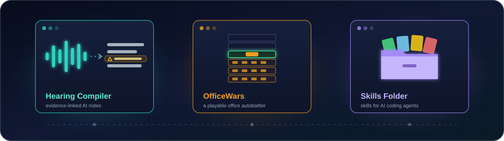
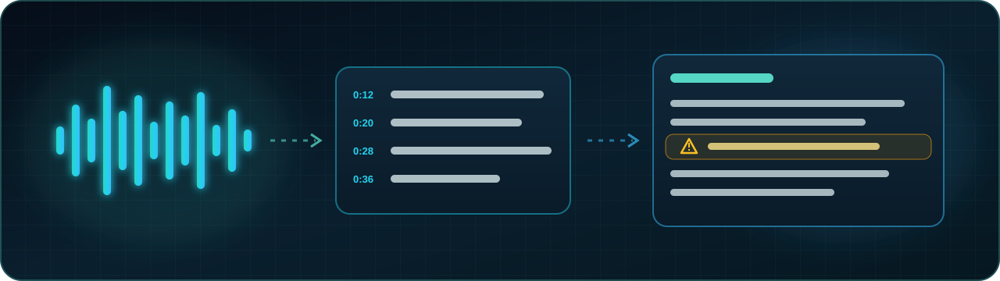
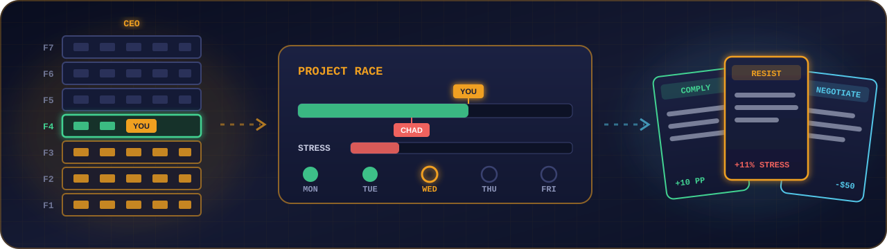
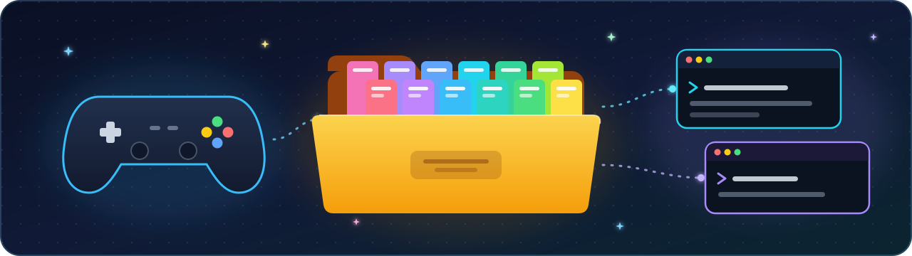
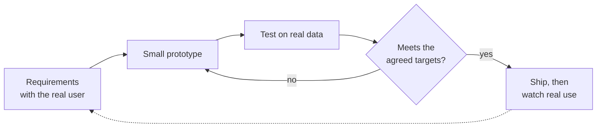

# Hi, I'm Quan

I build useful tools and games by directing AI coding agents, and I measure
whether the results are actually right.

  
  
  
  

[**Hearing Compiler**](https://github.com/mewzicians/hearing-compiler-case-study)
· [**OfficeWars**](https://github.com/mewzicians/OfficeWars)
· [**Skills Folder**](https://github.com/mewzicians/Skills-Folder)
· [**How I work**](#how-i-work)

## Projects

### Hearing Compiler: case study and code

A Mac app that turns multi-hour public hearings into reviewable,
source-linked notes, so the reviewer only listens where it matters. It's in
real use by one legislative staff member.

- **Evidence over trust:** code locates every quote the AI gives (232 of 233 on
  a fresh hearing), and flag-only checks can add ⚠ but never change a value.
- **Measured:** a second AI check caught 11 of 13 known errors, and an audio
  check found a wrong figure nobody had flagged.
- **Start with:** the [evaluation](https://github.com/mewzicians/hearing-compiler-case-study/blob/main/docs/EVALUATION.md),
  then the [decisions](https://github.com/mewzicians/hearing-compiler-case-study/blob/main/docs/DECISIONS.md).

### OfficeWars: a playable game

A single-file office autobattler: climb seven corporate floors before Stress,
the workweek, or Chad ends the run. No install or build step.

- **Play it:** [in the browser](https://mewzicians.github.io/OfficeWars/officewarsautobattler.html).
- **Built with rules:** every design value has a state (Locked, Draft,
  Open...) in a balance ledger, and agents work from a written source
  hierarchy.
- **Verified:** browser checks across screen sizes and 200% text, with
  results reported Pass, Fail, Not Run, or Blocked.
- **Start with:** [How it's built](https://github.com/mewzicians/OfficeWars#how-its-built).

### Skills Folder: skills for AI coding agents

Twelve reusable skills that teach Codex or Claude Code how to plan, build,
test, balance, and release a game with you.

- **Portable:** no engine, genre, or game baked in; an optional project
  profile points the skills at each game's own files.
- **Tested:** every check runs in CI on Windows, macOS, and Linux.
- **Start with:** [the 12 skills](https://github.com/mewzicians/Skills-Folder#the-12-skills).

## How I work

- **I make the calls; agents propose.** Projects have written rules and a
  source of truth for every fact. Nothing becomes approved, promoted, or
  shipped without me.
- **Real data early.** One real hearing exposed problems that weeks of
  synthetic tests hadn't.
- **Targets before tuning.** I set what "good" means first, such as recall
  before precision on the compiler, so a metric can't be gamed later.
- **Independent review.** Separate reviewer agents check each feature; they
  found real defects in every feature they reviewed.
- **Nothing is lost.** Decisions, rejected ideas with their reasons, and
  handoffs are written down, so any session can pick up where the last one
  stopped.

## Find what you need

| Looking for | Go to |
|---|---|
| Evaluation and metrics | [Hearing Compiler evaluation](https://github.com/mewzicians/hearing-compiler-case-study/blob/main/docs/EVALUATION.md) |
| Architecture and code | [Hearing Compiler architecture](https://github.com/mewzicians/hearing-compiler-case-study/blob/main/docs/ARCHITECTURE.md) |
| Something to play | [OfficeWars in the browser](https://mewzicians.github.io/OfficeWars/officewarsautobattler.html) |
| How I set up AI agents | [Skills Folder](https://github.com/mewzicians/Skills-Folder) and [Working With Agents](https://github.com/mewzicians/OfficeWars/blob/main/docs/WORKING_WITH_AGENTS.md) |
